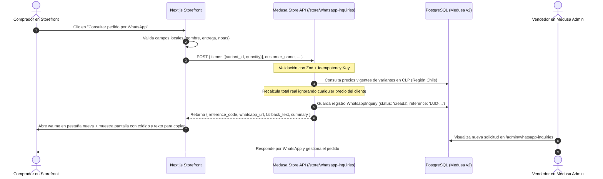

# Arquitectura del Sistema — Lúdicamente (V1)

## 1. Visión General del Sistema

**Lúdicamente** es una plataforma de comercio electrónico orientada a juegos de mesa, juguetes didácticos y material educativo en Chile.

La **Versión 1 (V1)** implementa el modelo **"Catálogo + Carrito Cotizador hacia WhatsApp con Trazabilidad en Backend"**:
- **Catálogo público:** Experiencia visual enriquecida, rápida y accesible construida en Next.js (App Router).
- **Carrito persistente:** Manejo de variantes, cantidades y cálculo estricto en Pesos Chilenos (CLP, sin decimales).
- **Conversión V1:** El flujo de compra finaliza con una **Solicitud de Pedido** trazada en el backend de Medusa v2 con código único (ej. `LUD-000101`), recálculo server-side de precios y redirección estructurada a WhatsApp (`wa.me`), manteniendo una pantalla de contingencia (copia de portapapeles y botón de reintento).
- **Desacoplamiento V2:** El catálogo, los productos, las regiones y los carritos utilizan las primitivas estándar de Medusa v2. En la V2 se conectarán pasarelas de pago chilenas (Webpay Plus, Flow, Mercado Pago) sin necesidad de reconstruir el frontend ni el catálogo.

---

## 2. Topología del Monorepo

```
/
├── apps/
│   ├── backend/               # Medusa.js v2 Engine + Admin UI
│   │   ├── src/
│   │   │   ├── modules/
│   │   │   │   ├── whatsapp-inquiry/  # Módulo personalizado de Solicitudes WhatsApp
│   │   │   │   └── store-settings/    # Configuración de tienda (Teléfono E.164, Textos Hero, etc.)
│   │   │   ├── workflows/             # Medusa Workflows SDK (creación de solicitud, etc.)
│   │   │   ├── api/                   # Custom API Routes (/store/whatsapp-inquiries, etc.)
│   │   │   ├── admin/
│   │   │   │   ├── routes/            # UI Routes de Medusa Admin (Gestión de Solicitudes)
│   │   │   │   └── widgets/           # Widgets para paneles de Admin
│   │   │   └── scripts/               # Scripts de seed DEMO seguro
│   │   ├── medusa-config.ts           # Configuración defineConfig (Medusa v2)
│   │   ├── package.json
│   │   └── tsconfig.json
│   │
│   └── storefront/            # Next.js 14/15 (App Router)
│       ├── src/
│       │   ├── app/                   # App Router: /, /catalogo, /producto/[handle], /categoria/[handle], /carrito
│       │   ├── components/            # UI Components (Header, Footer, ProductCard, Drawer, etc.)
│       │   ├── lib/                   # Medusa JS SDK client, formateadores CLP, helpers
│       │   └── types/                 # Definiciones TypeScript compartidas
│       ├── tailwind.config.ts         # Tokens de diseño Lúdicamente
│       ├── package.json
│       └── tsconfig.json
│
├── docs/                      # Documentación viva del proyecto
│   ├── ARCHITECTURE.md        # Este documento
│   ├── DECISIONS.md           # Registro de Decisiones de Arquitectura (ADR)
│   ├── DESIGN.md              # Sistema de Diseño, Tokens y Reglas UI/UX
│   ├── OPERACION_CLIENTE.md   # Guía paso a paso para el administrador de tienda
│   └── ROADMAP.md             # Plan de evolución V2 (Pasarelas de pago, despachos)
│
├── package.json               # Monorepo root con scripts de conveniencia
└── README.md
```

---

## 3. Módulos y Flujos de Datos

### 3.1 Módulo `whatsapp-inquiry` (Medusa v2 Custom Module)
Implementado bajo la especificación estricta de Medusa v2:
- Definición de modelo con `model.define` desde `@medusajs/framework/utils`.
- Servicio exportado vía `MedusaService({ WhatsappInquiry })`.
- Workflow transaccional vía `createWorkflow` y `createStep` desde `@medusajs/framework/workflows-sdk`.

#### Modelo de Datos `WhatsappInquiry`:
- `id`: ID generado automáticamente por Medusa (`inq_...`).
- `reference_code`: Código comercial amigable (ej: `LUD-000101`).
- `status`: Enum (`creada`, `contacto_iniciado`, `en_revision`, `mix_confirmado`, `cerrada`, `cancelada`).
- `customer_name`: Nombre del solicitante.
- `customer_phone`: Teléfono de contacto opcional.
- `delivery_preference`: Preferencia (`retiro`, `despacho_por_coordinar`).
- `customer_notes`: Notas o requerimientos especiales (máximo 500 caracteres, sanitizado).
- `initial_items_snapshot`: Snapshot JSON inmutable de variantes, títulos, SKUs, cantidades y precios unitarios en CLP calculados al momento de crear la solicitud.
- `initial_total_clp`: Subtotal recalculado en el backend en CLP.
- `confirmed_items_snapshot`: Snapshot editable por el vendedor en Medusa Admin en caso de reemplazo de ítems o confirmación de stock.
- `confirmed_total_clp`: Total final acordado con el cliente en WhatsApp.
- `whatsapp_opened_at`: Marca temporal del primer clic hacia WhatsApp (señal técnica de apertura, no confirmación de venta).
- `internal_notes`: Historial y notas internas del equipo de ventas.
- `idempotency_key`: Clave para prevenir registros duplicados ante doble envío.

### 3.2 Flujo Transaccional de Creación de Solicitud (`POST /store/whatsapp-inquiries`)


---

## 4. Reglas de Negocio V1
1. **Moneda e Importes:** Todos los precios en CLP son enteros sin decimales (`maximumFractionDigits: 0`).
2. **Disponibilidad:** Las variantes demo tienen `manage_inventory: false`. El storefront muestra la etiqueta clara *"Disponibilidad por confirmar"*.
3. **Desacoplamiento:** Medusa Cart y Product Models operan nativamente. La solicitud de WhatsApp es un paso de prospección/cotización que no destruye el estado nativo de Medusa.
4. **Seguridad y Confianza:** Ningún precio enviado desde el navegador es considerado válido; el backend siempre consulta el catálogo oficial antes de emitir la cotización.
