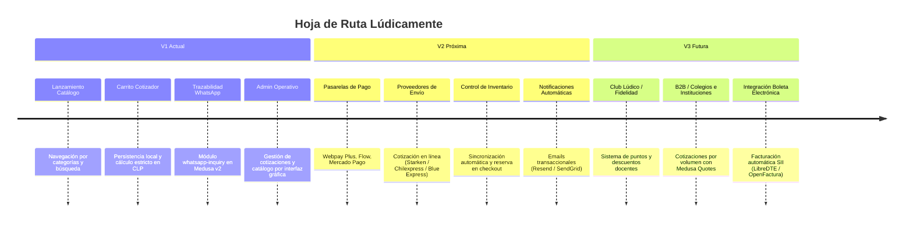

# Roadmap Estratégico y Técnico — Lúdicamente

## 1. Evolución por Fases

---

## 2. Integración de Pasarelas Chilenas en V2 (Arquitectura de Pagos Medusa v2)

En Medusa v2, el sistema de pagos se desacopla mediante el **Payment Module** y los **Payment Providers**. Para activar pagos online chilenos en V2, **no será necesario reconstruir el catálogo ni el carrito actual**.

### 2.1 Pasarelas Candidatas para Chile
1. **Transbank Webpay Plus (vía REST):**
   - Estándar bancario chileno (débito Redcompra y crédito en cuotas).
   - Implementación: Módulo proveedor `medusa-payment-webpay` implementando `AbstractPaymentProvider`.
2. **Flow.cl:**
   - Agregador de pagos con soporte Webpay, Servipag, Mach y transferencias.
   - Ideal por su rápida integración y soporte de webhooks automáticos.
3. **Mercado Pago Chile:**
   - Alta tasa de conversión móvil, pago con saldo en cuenta y tarjetas.
4. **Khipu / Fintoc:**
   - Transferencia bancaria automatizada directa (bajo costo por transacción).

### 2.2 Flujo de Transición Técnica (V1 -> V2)
- El carrito (`cart`) de Medusa v2 ya existe y gestiona los ítems en CLP.
- En la V2, el botón *"Consultar pedido por WhatsApp"* se complementará con la opción *"Pagar en línea"*.
- Al seleccionar pago en línea:
  1. Se inicializa una `PaymentCollection` en Medusa v2.
  2. El proveedor (ej. Webpay) genera el token de transacción e interactúa con el webhook de retorno.
  3. Al confirmarse el pago exitoso, Medusa crea la `Order` oficial y descuenta el inventario de forma automática.
- Las **Solicitudes de WhatsApp** seguirán existiendo como canal asistido para compras corporativas o clientes que prefieran atención personalizada.

---

## 3. Integración de Despachos y Logística (V2)

- **Fulfillment Providers:** Implementación de adaptadores para APIs de carriers locales:
  - *Starken:* Envíos a agencias y a domicilio a nivel nacional.
  - *Chilexpress:* Cobertura express en todo Chile.
  - *Blue Express:* Tarifas competitivas para e-commerce.
- **Retiro en Tienda / Punto Pick-up:** Mantenimiento de la opción de retiro sin costo con notificación cuando el pedido esté listo.

---

## 4. Facturación Electrónica SII (V3)
- Conexión vía webhooks tras orden pagada hacia un facturador (ej. OpenFactura o LibreDTE) para emisión automática de Boleta Electrónica exenta/afecta según corresponda.
